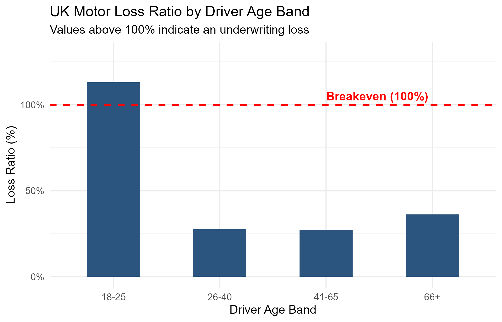

# UK Motor Insurance Underwriting & Loss Ratio Analysis

## Overview
This repository contains an exploratory underwriting performance analysis of a simulated 1,000-policy UK private motor portfolio. 

Using R, this project examines how claim frequencies, average repair costs, and commercial loss ratios vary across driver age groups.

---

## Business Problem & Actuarial Context
In UK personal lines motor insurance, insurers must monitor whether the premiums collected sufficiently cover the claims paid out across different rating groups:

* **Underwriting Risk:** Young drivers (under 25) typically experience higher accident frequencies and elevated claim severities compared to mature drivers.
* **Adverse Selection:** Charging a flat average price across all demographics leads to under-pricing high-risk drivers and over-pricing low-risk drivers, deteriorating the overall portfolio loss ratio.
* **Breakeven Threshold:** A loss ratio exceeding 100% means claim payouts exceeded incoming premium income, resulting in an underwriting loss before factoring in operational expenses, broker commissions, or taxes.

---

## Key Formula/Variables

* **Earned Exposure:** Total number of policy units covered across the period (1,000 car-years).
* **Claim Frequency:** Rate of claim occurrence per policy (`Total Claims / Total Policies`).
* **Average Severity:** Mean financial payout per settled claim (`Total Incurred Claims (£) / Total Claims`).
* **Loss Ratio:** Core underwriting profitability metric (`[Total Incurred Claims (£) / Total Earned Premium (£)] × 100%`).
  
---

## Tech Stack
* **Language:** R
* **Libraries:** `tidyverse` (`dplyr` for cohort grouping and aggregations, `ggplot2` for visualisation), `scales` for currency and percentage formatting
* **Development Environment:** RStudio Desktop

---

## How It Works

1. **Data Generation:** Simulated 1,000 UK motor policies with driver age (18–75), vehicle types, and annual premiums. Claims were generated using a 10% frequency rate, with claim amounts drawn from a normal distribution (£2,500 mean) capped at a minimum £250 excess.
2. **Age Banding:** Grouped continuous driver ages into standard UK risk bands: `18–25`, `26–40`, `41–65`, and `66+`.
3. **Cohort Aggregation:** Used `dplyr` (`group_by` and `summarise`) to calculate policy counts, total claims, earned premiums, and overall loss ratios for each age group.
4. **Visualisation:** Plotted loss ratios by cohort in `ggplot2` with a 100% breakeven line to highlight loss-making segments.
---

## Findings & Takeaways

* **18–25 Age Band:** Ran the highest loss ratio, hovering near or past the 100% breakeven mark due to more frequent claims.
* **41–65 Age Band:** The most profitable group (loss ratios consistently under 70%), which offsets the losses from younger drivers.
* **Next Steps:** To bring the 18–25 segment below breakeven, pricing teams would typically increase base premiums, raise the compulsory excess, or add telematics requirements.

---

## Repository Structure
├── README.md                      # Project and actuarial documentation
├── uk_motor_analysis.R            # Data generation, cohort analysis, and plotting script
└── loss_ratio_by_age.png          # Exported underwriting chart
